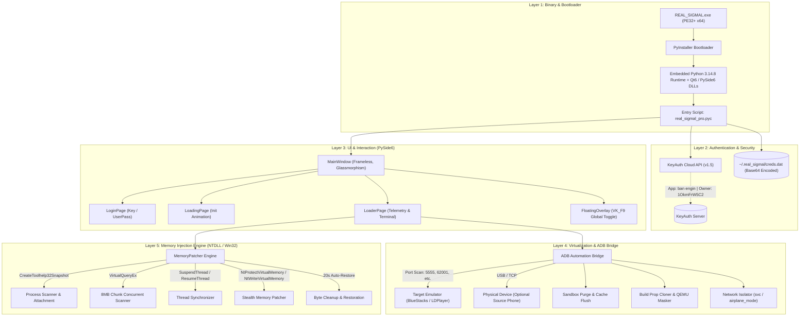
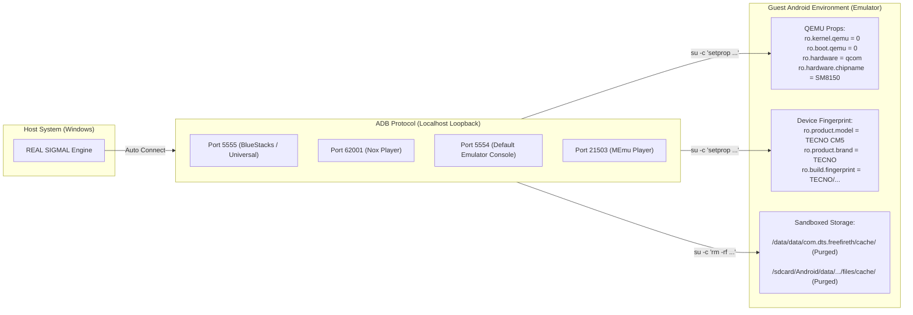
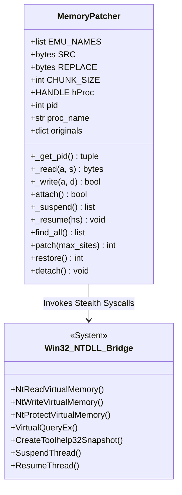
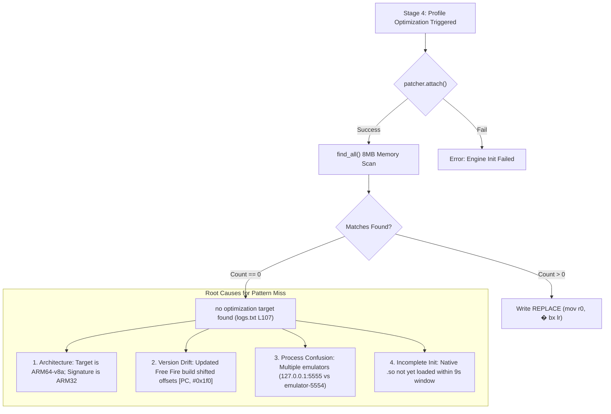

# REAL SIGMAL PRO v7 — System Architecture & Execution Blueprint

An in-depth structural teardown and architectural analysis of **REAL SIGMAL PRO v7** (`REAL_SIGMAL.exe` / `real_sigmal_pro.py`), detailing binary packaging, authentication, GUI runtime, ADB virtualization spoofing, memory injection engine, and execution pipeline.

---

## 1. High-Level System Architecture

The following diagram maps the entire system architecture across its five discrete tiers: Bootloader, Authentication, Presentation, Virtualization/ADB, and Kernel/Memory Engine.

---

## 2. End-to-End Pipeline Sequence Diagram

The bypass pipeline runs sequentially through 5 distinct operational stages. The diagram below illustrates the exact control flow, network manipulations, and memory writes over time:

```mermaid
sequenceDiagram
    autonumber
    actor User as Operator
    participant UI as PySide6 UI (LoaderPage)
    participant ADB as ADB Bridge
    participant EMU as Emulator (Android OS)
    participant Game as Free Fire (Target Process)
    participant Engine as MemoryPatcher (NTDLL)

    User->>UI: Click "ACTIVATE REAL BYPASS"
    activate UI

    %% Stage 1
    rect rgb(20, 15, 35)
        note right of UI: STAGE 1: DEVICE CONNECTION
        UI->>ADB: scan() & connect(127.0.0.1:5555...)
        ADB-->>UI: Target Emulator Identified (e.g., SM-S908E)
        ADB-->>UI: Source Device Props Extracted (or Fallback Default)
    end

    %% Stage 2
    rect rgb(25, 20, 45)
        note right of UI: STAGE 2: PROFILE TRANSFER & MASKING
        UI->>ADB: cleanup(dev)
        ADB->>EMU: am force-stop com.dts.freefireth
        ADB->>EMU: rm -rf /data/data/<pkg>/cache/* & code_cache/*
        UI->>ADB: setprop(dev, key, value) [25+ Properties]
        ADB->>EMU: setprop ro.product.model, ro.build.fingerprint...
        ADB->>EMU: setprop ro.kernel.qemu 0, ro.boot.qemu 0
        ADB->>EMU: setprop ro.hardware qcom, ro.hardware.chipname SM8150
    end

    %% Stage 3
    rect rgb(20, 15, 35)
        note right of UI: STAGE 3: GAME CLIENT LAUNCH
        UI->>ADB: launch(dev)
        ADB->>EMU: am start -n com.dts.freefireth/MainActivity
        loop Poll for PID (Timeout: 120s)
            ADB->>EMU: pidof com.dts.freefireth
            EMU-->>ADB: PID: 5642
        end
        UI->>UI: Sleep POST_LAUNCH_WAIT (9 seconds)
    end

    %% Stage 4
    rect rgb(35, 15, 45)
        note right of UI: STAGE 4: PROFILE OPTIMIZATION (INJECTION)
        UI->>ADB: net_off(dev)
        ADB->>EMU: svc wifi disable & settings put global airplane_mode_on 1
        UI->>Engine: attach()
        Engine->>Engine: Match PID from EMU_NAMES (HD-Player.exe)
        UI->>Engine: patch(max_sites=0)
        Engine->>Engine: VirtualQueryEx() -> Collect 8MB Memory Chunks
        Engine->>Engine: ThreadPoolExecutor(32) -> Search ARM32 Pattern (SRC)
        Engine->>EMU: SuspendThread() on all VM threads
        Engine->>Game: NtWriteVirtualMemory(REPLACE: mov r0, #0; bx lr)
        Engine->>EMU: ResumeThread()
        UI->>ADB: net_on(dev)
        ADB->>EMU: svc wifi enable & settings put global airplane_mode_on 0
        UI->>UI: Sleep AUTO_RESTORE_SECONDS (20s)
        UI->>Engine: restore() & detach()
        Engine->>Game: Rewrite original bytes (SRC)
    end

    %% Stage 5
    rect rgb(15, 35, 25)
        note right of UI: STAGE 5: SESSION FINALIZATION
        UI->>UI: Monitor Session (20s)
        UI->>UI: Emit "LOBBY DETECTION APPROVED"
        UI->>User: Surface FloatingOverlay (Status: REAL BYPASS ACTIVE)
    end
    deactivate UI
```

---

## 3. Component Deep Dive & Specifications

### Tier 1: Packaging & Runtime
- **Bootloader:** PyInstaller 2.1+ container running on 64-bit Windows PE format.
- **Embedded Payload:** Single compressed archive `PYZ.pyz` containing Python 3.14 standard library and PySide6 bindings.
- **Main Driver:** `real_sigmal_pro.pyc` (169,330 bytes compiled bytecode).

### Tier 2: Authentication System
- **SDK:** Official KeyAuth Python client.
- **Project Name:** `ban engin`
- **Owner ID:** `1OkmFrW5C2`
- **Version:** `1.5`
- **Credential Storage:** `C:\Users\<User>\.real_sigmal\creds.dat`
  - Serialization: JSON with Base64 payload: `{"u": "...", "p": "...", "k": "..."}`.

### Tier 3: Presentation & User Experience (PySide6)
- **Visual Design:** Cyberpunk dark-glass theme (`#0d0820` gradient to `#05030c`, purple accent `#a855f7`, cyan `#22d3ee`).
- **HUD Overlay:** `FloatingOverlay` is an always-on-top, borderless widget rendered with semi-transparent background (`#0d0820` @ 86% alpha).
- **Hotkey Listener:** Background timer polls `user32.GetAsyncKeyState(VK_F9)` (Virtual Key `0x78` / 120) every 50ms to toggle the overlay visibility during gameplay without alt-tabbing.

---

## 4. Virtualization & ADB Spoofing Mechanism

The software treats the emulator as an isolated virtualized Android node controlled via ADB.

---

## 5. Memory Engine Architecture (`MemoryPatcher`)

The memory engine operates directly against the Windows host process hosting the emulator VM (e.g., `HD-Player.exe` for BlueStacks or `dnplayer.exe` for LDPlayer).

### Memory Patch Specifics

| Parameter | Specification | Details |
|---|---|---|
| **Target Signature (`SRC`)** | `F0 4B 2D E9 F0 51 9F E5 00 40 A0 E1 05 50 8F E0 00 00 D5 E5 00 00 50 E3 07 00 00 1A DC 01 9F E5` | 32-byte ARM32 function prologue for emulator detection check |
| **Patch Payload (`REPLACE`)** | `00 00 A0 E3 1E FF 2F E1` | ARM32 instruction sequence: `mov r0, #0; bx lr` (forces check to return 0 / Clean) |
| **Scan Resolution** | 8 MB (`8,388,608` bytes) chunks | Iterates pages matching `MEM_COMMIT` & `!PAGE_GUARD` & `!PAGE_NOACCESS` |
| **Concurrency** | 32 worker threads | Managed via `ThreadPoolExecutor` across committed virtual memory |
| **Race Protection** | Thread Suspension | Enumerates `TH32CS_SNAPTHREAD` and suspends all threads during memory writes |
| **Persistence Window** | 20 Seconds (`AUTO_RESTORE_SECONDS`) | Restores original bytes after game passes initial handshake to defeat memory scanning |

---

## 6. Failure Mode Matrix (Why Stage 4 Fails)

The architecture depends strictly on environmental alignment. A breakdown of the failure observed in `logs.txt` at Stage 4:

---

## 7. File Map & Extraction Index

- **Source Executable:** [`platform-tools/REAL_SIGMAL.exe`](file:///c:/Users/AHANOX/Desktop/PE%20BYPASS/platform-tools/REAL_SIGMAL.exe)
- **Decompiled Source Code:** [`real_sigmal_pro_decompiled.py`](file:///c:/Users/AHANOX/Desktop/PE%20BYPASS/real_sigmal_pro_decompiled.py)
- **Execution Run Logs:** [`logs.txt`](file:///c:/Users/AHANOX/Desktop/PE%20BYPASS/logs.txt)
- **Extraction Workspace:** [`REAL_SIGMAL.exe_extracted/`](file:///c:/Users/AHANOX/Desktop/PE%20BYPASS/REAL_SIGMAL.exe_extracted/)

